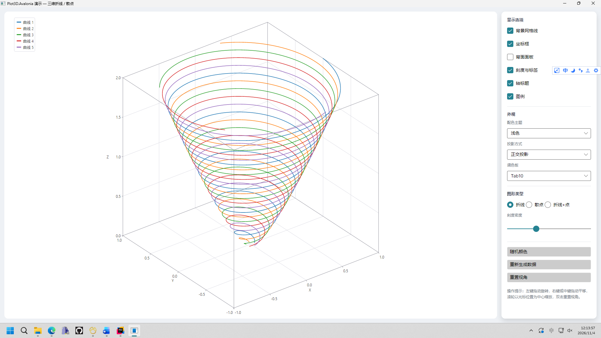
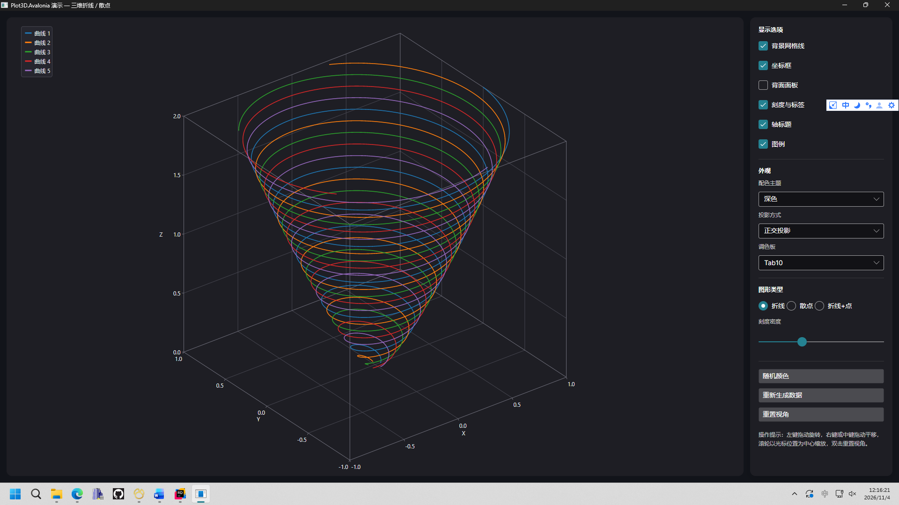
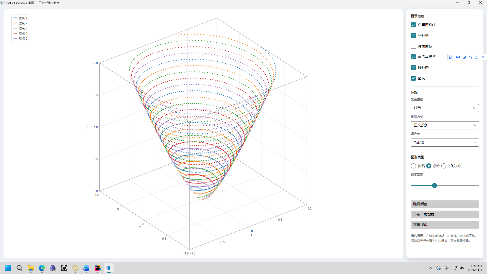

# Plot3D.Avalonia

面向 **Avalonia 12** 的轻量级三维绘图控件库，提供科学计算风格的三维折线图与散点图，交互与视觉参考主流科学计算软件（如 MATLAB® 的 `plot3` / `scatter3`）。

控件完全基于 Avalonia 绘图 API 自绘，不依赖 SkiaSharp、不依赖反射、不使用运行时 XAML，可直接用于 **NativeAOT / 裁剪（Trimming）** 发布。



---

## 目录

- [1. 特性](#1-特性)
- [2. 环境要求](#2-环境要求)
- [3. 安装](#3-安装)
- [4. 快速开始](#4-快速开始)
- [5. 数据系列](#5-数据系列)
- [6. 颜色与调色板](#6-颜色与调色板)
- [7. 相机、投影与交互](#7-相机投影与交互)
- [8. 坐标轴、网格与刻度](#8-坐标轴网格与刻度)
- [9. 主题与字体](#9-主题与字体)
- [10. 图例](#10-图例)
- [11. 属性参考](#11-属性参考)
- [12. 方法参考](#12-方法参考)
- [13. 性能指南](#13-性能指南)
- [14. AOT 与裁剪](#14-aot-与裁剪)
- [15. 打包与发布 NuGet](#15-打包与发布-nuget)
- [16. 扩展自定义图形](#16-扩展自定义图形)
- [17. 常见问题](#17-常见问题)
- [18. 版本与许可](#18-版本与许可)

---

## 1. 特性

| 分类 | 能力 |
| --- | --- |
| 图形 | 三维折线（`LineSeries3D`）、三维散点（`ScatterSeries3D`），可组合绘制 |
| 相机 | 轨道相机（方位角 / 仰角）、正交投影与透视投影、缩放、平移、双击复位 |
| 坐标系 | 自动取整的坐标范围、可手动指定范围、自动刻度与标签、轴标题 |
| 外观 | 背景色、网格开关、坐标框开关、背面面板开关、刻度开关、轴标题开关 |
| 配色 | 自动调色板 / 固定颜色 / 随机颜色，内置 7 套调色板，支持透明度与线型 |
| 交互 | 左键拖动旋转、右键/中键拖动平移、滚轮以光标为中心缩放 |
| 主题 | 内置浅色 / 深色主题，所有颜色均可单独覆盖 |
| 工程 | 场景缓存、批量几何绘制、文字布局缓存、无需反射，AOT / 裁剪安全 |



---

## 2. 环境要求

- .NET 8.0 / .NET 9.0 / .NET 10.0（库同时提供 `net8.0`、`net9.0`、`net10.0` 目标）
- Avalonia **12.1+**

> 控件目标框架与宿主应用无关：`net8.0` 宿主使用 `net8.0` 目标，`net9.0` / `net10.0` 宿主会优先匹配同名目标。

---

## 3. 安装

### 3.1 引用项目（本地开发）

直接把 `src/Plot3D.Avalonia/Plot3D.Avalonia.csproj` 加入你的解决方案，然后在宿主项目里添加项目引用：

```xml
<ItemGroup>
  <ProjectReference Include="..\3D控件\src\Plot3D.Avalonia\Plot3D.Avalonia.csproj" />
</ItemGroup>
```

### 3.2 引用 NuGet 包（发布后）

```bash
dotnet add package Plot3D.Avalonia --version 1.0.0
```

或手工在 csproj 中添加：

```xml
<ItemGroup>
  <PackageReference Include="Plot3D.Avalonia" Version="1.0.0" />
</ItemGroup>
```

---

## 4. 快速开始

### 4.1 引入 XAML 命名空间

控件库注册了专用 XML 命名空间：

```xml
xmlns:plot3d="https://github.com/daipeng0809/Plot3D.Avalonia"
```

### 4.2 XAML + 代码

**MainWindow.axaml**

```xml
<Window xmlns="https://github.com/avaloniaui"
        xmlns:x="http://schemas.microsoft.com/winfx/2006/xaml"
        xmlns:plot3d="https://github.com/daipeng0809/Plot3D.Avalonia"
        x:Class="MyApp.MainWindow"
        Title="三维绘图" Width="1000" Height="700">

  <Grid ColumnDefinitions="*,280">
    <plot3d:Plot3DView x:Name="Plot"
                       Grid.Column="0"
                       ShowGrid="True"
                       ShowLegend="True"
                       ColorTheme="Light"
                       XAxisTitle="X"
                       YAxisTitle="Y"
                       ZAxisTitle="Z" />

    <StackPanel Grid.Column="1" Margin="12" Spacing="8">
      <Button Content="重置视角" Click="OnResetView" />
    </StackPanel>
  </Grid>
</Window>
```

**MainWindow.axaml.cs**

```csharp
using System;
using Plot3D.Avalonia.Controls;
using Plot3D.Avalonia.Modeling;

namespace MyApp;

public partial class MainWindow : Window
{
    public MainWindow()
    {
        InitializeComponent();
        PlotSeries();

        var plot = this.FindControl<Plot3DView>("Plot")!;
        // ……
    }

    private void PlotSeries()
    {
        var plot = this.FindControl<Plot3DView>("Plot")!;
        var series = new LineSeries3D { Title = "螺旋线", StrokeThickness = 1.6 };

        var points = new Point3D[720];
        for (var i = 0; i < points.Length; i++)
        {
            var t = i / (double)(points.Length - 1);
            var angle = t * Math.PI * 10.0;
            var radius = 0.05 + 0.95 * Math.Pow(t, 0.8);

            points[i] = new Point3D(
                radius * Math.Cos(angle),
                radius * Math.Sin(angle),
                2.0 * t);
        }

        series.SetPoints(points);
        plot.Series.Add(series);
    }

    private void OnResetView(object? sender, Avalonia.Interactivity.RoutedEventArgs e)
    {
        this.FindControl<Plot3DView>("Plot")!.ResetView();
    }
}
```

### 4.3 纯代码创建（无 XAML）

```csharp
using Avalonia.Controls;
using Plot3D.Avalonia.Controls;
using Plot3D.Avalonia.Modeling;

var plot = new Plot3DView
{
    ShowGrid = true,
    ShowLegend = true,
    ColorTheme = PlotTheme.Dark,
    Margin = new Avalonia.Thickness(12),
};

var scatter = new ScatterSeries3D
{
    Title = "点云",
    MarkerSize = 4,
    MarkerShape = MarkerShape.Circle,
};

scatter.SetPoints(points);
plot.Series.Add(scatter);
```

---

## 5. 数据系列

### 5.1 折线：`LineSeries3D`

```csharp
var line = new LineSeries3D
{
    Title = "温度曲线",
    StrokeThickness = 1.8,
    LineStyle = LineStyle.Solid,
    MarkerSize = 0,          // > 0 时同时绘制顶点标记
    MarkerShape = MarkerShape.Circle,
    ColorMode = SeriesColorMode.Auto,
};

// 一次替换全部数据
line.SetPoints(points);

// 逐点追加（每次都会触发刷新，适合低频更新）
line.Add(new Point3D(1, 2, 3));

// 批量追加
line.AddRange(points);

// 清空
line.Clear();
```

**NaN 断线**：折线遇到 `NaN` / `Infinity` 坐标时会自动断开，可用于绘制分段曲线：

```csharp
line.SetPoints(new[]
{
    new Point3D(0, 0, 0),
    new Point3D(1, 1, 1),
    new Point3D(double.NaN, double.NaN, double.NaN), // 断开
    new Point3D(2, 0, 0),
    new Point3D(3, 1, 1),
});
```

**高性能批量写入**：直接操作 `Points` 列表后手动通知，可避免逐点触发刷新：

```csharp
line.Points.Clear();
foreach (var p in hugeBuffer)
{
    line.Points.Add(p);
}
line.InvalidateData();   // 只刷新一次
```

### 5.2 散点：`ScatterSeries3D`

```csharp
var scatter = new ScatterSeries3D
{
    Title = "采样点",
    MarkerSize = 5,
    MarkerShape = MarkerShape.Diamond,  // Circle / Square / Diamond / Triangle
    Opacity = 0.85,
};

scatter.SetPoints(points);
```

散点默认 `MarkerSize = 6`。所有点会合并进一个几何体一次性填充，因此数万点也能保持流畅。



### 5.3 多系列组合

```csharp
plot.Series.Add(new LineSeries3D(p1) { Title = "曲线 A" });
plot.Series.Add(new LineSeries3D(p2) { Title = "曲线 B" });
plot.Series.Add(new ScatterSeries3D(p3) { Title = "散点", MarkerSize = 4 });
```

`Series` 是 `PlotSeries3DCollection`（继承自 `AvaloniaList<PlotSeries3D>`），支持 XAML 声明、集合变更通知与数据绑定。

### 5.4 系列通用属性

| 属性 | 类型 | 默认值 | 说明 |
| --- | --- | --- | --- |
| `Title` | `string?` | `null` | 图例名称 |
| `IsVisible` | `bool` | `true` | 是否参与绘制与范围计算 |
| `ColorMode` | `SeriesColorMode` | `Auto` | 取色方式 |
| `Color` | `Color` | `SteelBlue` | 固定颜色 |
| `Opacity` | `double` | `1.0` | 透明度（0..1） |
| `StrokeThickness` | `double` | `1.5` | 线宽（DIP） |
| `LineStyle` | `LineStyle` | `Solid` | `Solid` / `Dash` / `Dot` / `DashDot` |
| `MarkerSize` | `double` | `0`（散点 `6`） | 标记尺寸，0 表示不画点 |
| `MarkerShape` | `MarkerShape` | `Circle` | 标记形状 |

---

## 6. 颜色与调色板

### 6.1 三种取色方式

```csharp
// 1) 自动：按系列顺序从调色板取色；若显式设置过 Color 则优先使用 Color
series.ColorMode = SeriesColorMode.Auto;

// 2) 固定颜色
series.ColorMode = SeriesColorMode.Fixed;
series.Color = Colors.Crimson;

// 3) 随机颜色：每条系列只在首次绘制时生成一次，之后保持不变
series.ColorMode = SeriesColorMode.Random;
```

> `Auto` 模式下若显式赋值过 `series.Color`，则使用该颜色而不是调色板。需要强制走调色板时使用 `series.ClearValue(PlotSeries3D.ColorProperty)`。

### 6.2 内置调色板

| 调色板 | 风格 |
| --- | --- |
| `PlotPalette.Tab10` | Matplotlib tab10（默认） |
| `PlotPalette.Tab20` | Matplotlib tab20 |
| `PlotPalette.Classic` | 经典 7 色（科学计算软件常见默认配色） |
| `PlotPalette.Set1` | ColorBrewer Set1 |
| `PlotPalette.Pastel` | 柔和浅色 |
| `PlotPalette.Vivid` | 高对比 |
| `PlotPalette.Dark` | 深色背景专用亮色 |

```csharp
plot.Palette = PlotPalette.Classic;
```

> 以上调色板只包含颜色数值，不包含任何第三方代码。`Tab10` / `Tab20` 为 Matplotlib 默认配色，`Set1` 来自 ColorBrewer，色值均按公开信息整理。

也可以自定义任意调色板：

```csharp
plot.Palette = new[]
{
    Color.Parse("#2563EB"),
    Color.Parse("#F97316"),
    Color.Parse("#10B981"),
};
```

### 6.3 透明度

`Opacity` 会与颜色自身的 Alpha 相乘，实现半透明叠加效果：

```csharp
scatter.Opacity = 0.35;
```

---

## 7. 相机、投影与交互

### 7.1 方位角与仰角

相机语义与主流科学计算软件的 `view(az, el)` 一致：

- **方位角 `Azimuth`**：绕 Z 轴旋转，`0` 时相机位于 **-Y** 方向，正值逆时针（俯视）旋转；默认 `-37.5`。
- **仰角 `Elevation`**：与 XY 平面的夹角，范围 `-90..90`；默认 `30`。

```csharp
plot.Azimuth = -37.5;
plot.Elevation = 30;
```

### 7.2 投影方式

```csharp
plot.Projection = ProjectionMode.Orthographic; // 正交（默认）
plot.Projection = ProjectionMode.Perspective;  // 透视，有近大远小
```

### 7.3 缩放与平移

```csharp
plot.Zoom = 1.5;      // 缩放倍数（0.02 .. 100）
plot.PanX = 0;        // 只读，反映当前平移量
plot.ResetZoom();     // 复位缩放与平移
plot.ResetCamera();   // 复位方位角与仰角
plot.ResetView();     // 全部复位
```

### 7.4 鼠标 / 触摸操作

| 操作 | 行为 |
| --- | --- |
| 左键拖动 | 旋转（方位角 + 仰角） |
| 右键 / 中键拖动 | 平移 |
| 滚轮 | 以光标位置为中心缩放 |
| 双击 | 重置视角 |

交互可通过属性关闭：

```csharp
plot.IsRotationEnabled = false;
plot.IsPanEnabled = false;
plot.IsZoomEnabled = false;
plot.ResetOnDoubleClick = false;

plot.RotationSensitivity = 0.5;  // 度 / 像素
plot.ZoomSensitivity = 0.15;     // 每格滚轮的指数增量
```

---

## 8. 坐标轴、网格与刻度

### 8.1 自动范围

默认根据所有可见系列的数据包围盒自动计算范围，并对齐到“好看”的刻度（1 / 2 / 2.5 / 5 × 10ⁿ）。
空数据时显示 `0..1` 的默认坐标框；所有点重合时会自动扩展出可见范围。

### 8.2 手动指定范围

只设置最小值或最大值也可以，未设置的一端继续自动计算：

```csharp
plot.XAxisMinimum = -1;
plot.XAxisMaximum = 1;

plot.ZAxisMinimum = 0;
plot.ZAxisMaximum = 2;

// 恢复自动
plot.XAxisMinimum = double.NaN;
```

### 8.3 刻度数量

```csharp
plot.TickCount = 6;   // 每个轴期望的刻度数量（含两端），有效范围 2..20
```

刻度文本会根据步长自动选择小数位，极大 / 极小数值自动切换为科学计数法。

### 8.4 显示开关

```csharp
plot.ShowGrid = true;         // 背景网格线
plot.ShowBox = true;          // 坐标框（12 条棱）
plot.ShowPane = false;        // 背面墙填充
plot.ShowTicks = true;        // 刻度线
plot.ShowTickLabels = true;   // 刻度文本
plot.ShowAxisTitles = true;   // 轴标题

plot.XAxisTitle = "X (m)";
plot.YAxisTitle = "Y (m)";
plot.ZAxisTitle = "Z (m)";
```

### 8.5 留白

刻度标签与轴标题绘制在坐标框外侧，通过 `PlotPadding` 预留空间：

```csharp
plot.PlotPadding = new Thickness(56, 40, 56, 40); // 左、上、右、下
```

当字号较大或标签很长时，适当增大留白。

---

## 9. 主题与字体

### 9.1 内置主题

```csharp
plot.ColorTheme = PlotTheme.Light;  // 白色背景、深灰文字
plot.ColorTheme = PlotTheme.Dark;   // 深色背景、浅色文字
```

主题只影响**未显式设置**的颜色。

### 9.2 单独覆盖颜色

```csharp
plot.Background = new SolidColorBrush(Color.Parse("#0F172A"));
plot.Foreground = Brushes.White;
plot.AxisBrush = new SolidColorBrush(Color.Parse("#94A3B8"));
plot.GridBrush = new SolidColorBrush(Color.Parse("#334155"));
plot.PaneBrush = new SolidColorBrush(Color.Parse("#1E293B"));
plot.LegendBackground = new SolidColorBrush(Color.FromArgb(210, 15, 23, 42));

// 完全透明背景（叠在其他内容上）
plot.Background = Brushes.Transparent;
```

### 9.3 字体

```csharp
plot.FontFamily = new FontFamily("avares://MyApp/Assets/Fonts/AlibabaPuHuiTi.ttf#Alibaba PuHuiTi 3.0");
plot.FontSize = 13;
```

字体只影响刻度、轴标题与图例文本。

---

## 10. 图例

```csharp
plot.ShowLegend = true;
series.Title = "曲线 A";
```

- 只有设置了非空 `Title` 且 `IsVisible = true` 的系列才会出现在图例中。
- 图例固定在控件左上角，背景色由 `LegendBackground` 控制（未设置时使用主题色）。

---

## 11. 属性参考

### 11.1 `Plot3DView`

#### 数据与配色

| 属性 | 类型 | 默认值 | 说明 |
| --- | --- | --- | --- |
| `Series` | `PlotSeries3DCollection` | 空集合 | 数据系列集合 |
| `Palette` | `IReadOnlyList<Color>?` | `PlotPalette.Tab10` | 自动取色调色板 |
| `Background` | `IBrush?` | 主题背景 | 背景画刷 |
| `Foreground` | `IBrush?` | 主题文字色 | 刻度 / 标题 / 图例文字 |
| `AxisBrush` | `IBrush?` | 主题坐标轴色 | 坐标框与刻度线 |
| `GridBrush` | `IBrush?` | 主题网格色 | 网格线与图例边框 |
| `PaneBrush` | `IBrush?` | 主题面板色 | 背面墙填充 |
| `LegendBackground` | `IBrush?` | 半透明主题色 | 图例背景 |
| `ColorTheme` | `PlotTheme` | `Light` | 浅色 / 深色主题 |

#### 显示开关

| 属性 | 类型 | 默认值 |
| --- | --- | --- |
| `ShowBox` | `bool` | `true` |
| `ShowGrid` | `bool` | `true` |
| `ShowPane` | `bool` | `false` |
| `ShowTicks` | `bool` | `true` |
| `ShowTickLabels` | `bool` | `true` |
| `ShowAxisTitles` | `bool` | `true` |
| `ShowLegend` | `bool` | `false` |

#### 坐标轴

| 属性 | 类型 | 默认值 | 说明 |
| --- | --- | --- | --- |
| `XAxisTitle` / `YAxisTitle` / `ZAxisTitle` | `string?` | `"X"` / `"Y"` / `"Z"` | 轴标题，设为空字符串可隐藏 |
| `XAxisMinimum` / `XAxisMaximum` | `double` | `NaN` | X 范围，`NaN` 表示自动 |
| `YAxisMinimum` / `YAxisMaximum` | `double` | `NaN` | Y 范围 |
| `ZAxisMinimum` / `ZAxisMaximum` | `double` | `NaN` | Z 范围 |
| `TickCount` | `int` | `6` | 期望刻度数量（2..20） |
| `PlotPadding` | `Thickness` | `56,40,56,40` | 绘图区留白 |

#### 相机与交互

| 属性 | 类型 | 默认值 | 说明 |
| --- | --- | --- | --- |
| `Azimuth` | `double` | `-37.5` | 方位角（度） |
| `Elevation` | `double` | `30` | 仰角（度，-89.9..89.9） |
| `Zoom` | `double` | `1.0` | 缩放倍数 |
| `Projection` | `ProjectionMode` | `Orthographic` | 投影方式 |
| `IsRotationEnabled` | `bool` | `true` | 是否允许拖动旋转 |
| `IsPanEnabled` | `bool` | `true` | 是否允许拖动平移 |
| `IsZoomEnabled` | `bool` | `true` | 是否允许滚轮缩放 |
| `ResetOnDoubleClick` | `bool` | `true` | 双击是否复位 |
| `RotationSensitivity` | `double` | `0.5` | 旋转灵敏度（度 / 像素） |
| `ZoomSensitivity` | `double` | `0.15` | 缩放灵敏度 |
| `PanX` / `PanY` | `double` | 只读 | 当前平移量（像素） |

#### 字体

| 属性 | 类型 | 默认值 |
| --- | --- | --- |
| `FontFamily` | `FontFamily` | `FontFamily.Default` |
| `FontSize` | `double` | `12` |

---

## 12. 方法参考

### 12.1 `Plot3DView`

| 方法 | 说明 |
| --- | --- |
| `ResetView()` | 复位方位角、仰角、缩放与平移 |
| `ResetCamera()` | 只复位方位角与仰角 |
| `ResetZoom()` | 只复位缩放与平移 |
| `InvalidatePlot()` | 强制重新计算自动范围并重绘（直接修改 `Points` 后调用） |

### 12.2 `LineSeries3D` / `ScatterSeries3D`

| 方法 | 说明 |
| --- | --- |
| `SetPoints(IEnumerable<Point3D>)` | 替换全部数据并刷新 |
| `SetPoints(ReadOnlySpan<Point3D>)` | 替换全部数据（零分配重载） |
| `Add(Point3D)` | 追加一个点并刷新 |
| `AddRange(IEnumerable<Point3D>)` | 追加多个点并刷新 |
| `Clear()` | 清空数据 |
| `InvalidateData()` | 直接修改 `Points` 后手动触发刷新 |
| `GetBounds()` | 返回数据包围盒（`BoundingBox3D`） |

属性 `Points` 返回底层 `List<Point3D>`，允许直接读写以换取最高性能；批量修改后记得调用 `InvalidateData()`。

---

## 13. 性能指南

### 13.1 已内置的优化

- **场景缓存**：只有当相机、尺寸、数据或相关属性变化时才重新计算投影与刻度，纯重绘不会重复计算。
- **批量几何**：整条折线合并为一个 `StreamGeometry` 一次描绘；所有散点合并为一个几何体一次填充，避免数万次 `DrawLine` / `DrawEllipse` 调用。
- **屏幕抽稀**：相邻点在屏幕上的距离小于 0.05 DIP 时自动跳过，大幅减少几何数据量。
- **小标记优化**：尺寸 ≤ 2.5 DIP 的标记使用四边形而非多边形，减少路径节点。
- **文字缓存**：刻度与标题的 `TextLayout` 只在字体、字号或前景色变化时重建。
- **画刷缓存**：主题画刷只在颜色属性变化时重建。
- **无反射 / 无 LINQ 热路径**：渲染循环使用 `Span<T>` 与索引遍历。

### 13.2 使用建议

| 场景 | 建议 |
| --- | --- |
| 实时数据（每秒多次更新） | 复用 `series.Points`，更新后调用一次 `InvalidateData()` |
| 数万点以上 | 优先使用 `ScatterSeries3D`（几何合并更彻底） |
| 超长折线（> 20 万点） | 在业务层降采样，或按屏幕像素抽稀后再传入 |
| 追求极致帧率 | 关闭 `ShowGrid` / `ShowTicks`，减少绘制批次 |
| 频繁切换数据 | 避免反复 `Series.Clear()`，复用系列对象并调用 `SetPoints` |

### 13.3 测量示例

```csharp
var sw = Stopwatch.StartNew();
series.SetPoints(points);   // 触发一次刷新
plot.InvalidatePlot();
sw.Stop();
Console.WriteLine($"数据更新耗时 {sw.Elapsed.TotalMilliseconds:F2} ms");
```

---

## 14. AOT 与裁剪

控件库本身已开启：

```xml
<IsAotCompatible>true</IsAotCompatible>
<IsTrimmable>true</IsTrimmable>
<EnableAotAnalyzer>true</EnableAotAnalyzer>
<EnableTrimAnalyzer>true</EnableTrimAnalyzer>
```

控件全部使用强类型 `AvaloniaProperty` 注册与代码绘制，没有 `TypeConverter` 反射、没有运行时 XAML、没有动态绑定，因此在 NativeAOT 与裁剪下无需额外配置。

宿主应用发布 NativeAOT：

```bash
dotnet publish -c Release -r win-x64 -p:PublishAot=true
```

宿主 csproj 建议：

```xml
<PropertyGroup>
  <PublishAot>true</PublishAot>
  <InvariantGlobalization>true</InvariantGlobalization>
</PropertyGroup>
```

> 若宿主在 XAML 中使用本控件，请确保 Avalonia 12 的 XAML 编译正常（默认 `AvaloniaUseCompiledBindingsByDefault=true`）；本库自身不包含任何 `.axaml` 资源。

---

## 15. 打包与发布 NuGet

### 15.1 本地打包

```bash
dotnet pack src/Plot3D.Avalonia/Plot3D.Avalonia.csproj -c Release -o ./artifacts
```

输出：

```
artifacts/
├── Plot3D.Avalonia.1.0.0.nupkg
├── Plot3D.Avalonia.1.0.0.snupkg
└── Plot3D.Avalonia.1.0.0.symbols.nupkg
```

包内包含：

- `lib/net8.0/Plot3D.Avalonia.dll`
- `lib/net9.0/Plot3D.Avalonia.dll`
- `lib/net10.0/Plot3D.Avalonia.dll`
- `lib/*/Plot3D.Avalonia.xml`（完整 XML 文档）
- `README.md`
- `icon.png`

### 15.2 本地测试包

```bash
dotnet nuget add source ./artifacts --name Plot3DLocal
dotnet add package Plot3D.Avalonia --version 1.0.0 --source Plot3DLocal
```

### 15.3 发布到 nuget.org

仓库内置了发布流水线 `.github/workflows/publish.yml`，推荐用它发布。

**方式一：GitHub Actions 自动发布（受信任发布，无需保管任何密钥）**

1. 在 nuget.org 的 **Trusted Publishing** 页面创建策略：
   - Package Owner：你的账号
   - CI/CD Provider：`GitHub Actions`
   - Repository Owner / Repository：GitHub 用户名 / 仓库名
   - Workflow File：`publish.yml`（**只填文件名**，不含 `.github/workflows/` 路径）
2. 触发发布，二选一：
   - 推送标签：`git tag v1.0.0` → `git push origin v1.0.0`，版本号自动取自标签
   - 在 Actions 页面手动运行 `Publish to NuGet`，可通过输入框临时覆盖版本号

流水线内部用 `NuGet/login@v1` 把 GitHub OIDC token 换成有效期 **1 小时**的临时 API Key，仓库和 Secrets 里都不保存长期密钥。

**方式二：本地手动推送**

```bash
# 1. 在 https://www.nuget.org 的 API Keys 页面创建长期密钥
# 2. 推送
dotnet nuget push ./artifacts/Plot3D.Avalonia.1.0.0.nupkg \
  --api-key <YOUR_API_KEY> \
  --source https://api.nuget.org/v3/index.json
```

发布前建议确认 `Plot3D.Avalonia.csproj` 中的：

```xml
<Authors>你的名字或团队</Authors>
<PackageProjectUrl>项目主页</PackageProjectUrl>
<RepositoryUrl>Git 仓库地址</RepositoryUrl>
<PackageLicenseExpression>MIT</PackageLicenseExpression>
<Version>1.0.0</Version>
```

> 版本号一经发布不可删除或覆盖，只能 unlist。需要修复时必须升版本号重新发布。

### 15.4 版本号约定

遵循语义化版本：

- `1.0.x`：缺陷修复
- `1.x.0`：向后兼容的新功能
- `2.0.0`：不兼容的 API 变更

---

## 16. 扩展自定义图形

内置只有折线与散点，后续可通过继承 `PlotSeries3D` 扩展曲面、柱状、矢量场等图形。

### 16.1 扩展点

```csharp
public abstract class PlotSeries3D : AvaloniaObject
{
    // 必须实现：返回数据包围盒，用于自动计算坐标轴范围
    public abstract BoundingBox3D GetBounds();

    // 必须实现：把图形绘制到控件
    protected internal abstract void Render(SeriesRenderContext context);

    // 可选：数据变化时通知控件
    protected void RaiseDataChanged();
}
```

`SeriesRenderContext` 提供：

| 成员 | 说明 |
| --- | --- |
| `DrawingContext` | 当前 Avalonia 绘图表面 |
| `Projection` | 三维到二维投影器（`TryProject` / `Project`） |
| `Color` | 已解析的系列颜色（含取色模式） |
| `Opacity` | 系列透明度 |
| `ViewBounds` | 控件绘制区域 |
| `CreateBrush()` | 用系列颜色创建画刷 |
| `CreatePen(thickness, style)` | 用系列颜色创建画笔 |

### 16.2 示例：三维柱状系列

```csharp
using Avalonia;
using Avalonia.Media;
using Plot3D.Avalonia.Modeling;
using Plot3D.Avalonia.Rendering;

public sealed class BarSeries3D : PlotSeries3D
{
    private readonly List<(Point3D Base, double Size)> _bars = new();

    public IReadOnlyList<(Point3D Base, double Size)> Bars => _bars;

    public void AddBar(Point3D basePoint, double size)
    {
        _bars.Add((basePoint, size));
        RaiseDataChanged();
    }

    public override BoundingBox3D GetBounds()
    {
        var bounds = BoundingBox3D.Empty;
        foreach (var (point, size) in _bars)
        {
            bounds = bounds
                .Union(point.X - size, point.Y - size, point.Z)
                .Union(point.X + size, point.Y + size, point.Z + size);
        }

        return bounds;
    }

    protected override void Render(SeriesRenderContext context)
    {
        var dc = context.DrawingContext;
        var brush = context.CreateBrush();
        var pen = context.CreatePen(0.8, LineStyle.Solid);

        foreach (var (basePoint, size) in _bars)
        {
            var bottom = new Point3D(basePoint.X, basePoint.Y, basePoint.Z);
            var top = new Point3D(basePoint.X, basePoint.Y, basePoint.Z + size);

            if (!context.TryProject(bottom, out var p0) || !context.TryProject(top, out var p1))
            {
                continue;
            }

            // 顶面四角
            var a = Project(context, basePoint.X - size, basePoint.Y - size, basePoint.Z + size);
            var b = Project(context, basePoint.X + size, basePoint.Y - size, basePoint.Z + size);
            var c = Project(context, basePoint.X + size, basePoint.Y + size, basePoint.Z + size);
            var d = Project(context, basePoint.X - size, basePoint.Y + size, basePoint.Z + size);

            var geometry = new StreamGeometry();
            using (var g = geometry.Open())
            {
                g.BeginFigure(a, true);
                g.LineTo(b);
                g.LineTo(c);
                g.LineTo(d);
                g.EndFigure(true);
            }

            dc.DrawGeometry(brush, pen, geometry);
            dc.DrawLine(pen, p0, p1);
        }
    }

    private static Point Project(SeriesRenderContext context, double x, double y, double z)
    {
        context.Projection.TryProject(x, y, z, out var px, out var py);
        return new Point(px, py);
    }
}
```

使用：

```csharp
var bars = new BarSeries3D { Title = "柱状", ColorMode = SeriesColorMode.Fixed, Color = Colors.SteelBlue };
bars.AddBar(new Point3D(0, 0, 0), 0.4);
bars.AddBar(new Point3D(1, 0, 0), 0.6);
plot.Series.Add(bars);
```

> 外部程序集重写 `Render` 时使用 `protected override`（`protected internal` 在外部程序集等价于 `protected`）。

### 16.3 建议

- 尽量把同类图元合并到一个 `StreamGeometry` 中一次性绘制。
- 避免在 `Render` 中分配大数组；如需缓存，使用字段并在 `DataChanged` 时失效。
- 及时在数据变化后调用 `RaiseDataChanged()`，否则自动范围不会更新。

---

## 17. 常见问题

**Q1：为什么坐标轴标签的重叠 / 留白不理想？**

调整 `PlotPadding`（增大四周留白）或 `TickCount`（减少刻度数）。字号较大时建议同时增大 `PlotPadding`。

**Q2：如何完全隐藏坐标轴，只显示数据？**

```csharp
plot.ShowBox = false;
plot.ShowGrid = false;
plot.ShowTicks = false;
plot.ShowAxisTitles = false;
```

**Q3：如何在 MVVM 中绑定数据？**

将 `Plot3DView.Series` 绑定到 ViewModel 中的 `PlotSeries3DCollection`：

```xml
<plot3d:Plot3DView Series="{Binding Series}" ShowLegend="True" />
```

`PlotSeries3DCollection` 继承自 `AvaloniaList<T>`，支持集合变更通知。

**Q4：如何在 XAML 中声明系列？**

建议在 XAML 中只声明系列与外观，点数据在代码中设置：

```xml
<plot3d:Plot3DView>
  <plot3d:Plot3DView.Series>
    <plot3d:PlotSeries3DCollection>
      <plot3d:LineSeries3D x:Name="SeriesA" Title="曲线 1" StrokeThickness="1.5" />
      <plot3d:ScatterSeries3D x:Name="SeriesB" Title="散点" MarkerSize="4" />
    </plot3d:PlotSeries3DCollection>
  </plot3d:Plot3DView.Series>
</plot3d:Plot3DView>
```

```csharp
SeriesA.SetPoints(pointsA);
SeriesB.SetPoints(pointsB);
```

> `Point3D` 是只读结构体（只有三参数构造函数），不适合在 XAML 中逐点声明；大量点请使用 `SetPoints`。

**Q5：如何导出图片？**

使用 Avalonia 的 `RenderTargetBitmap` 渲染控件：

```csharp
using Avalonia;
using Avalonia.Media.Imaging;

var dpi = 2.0;
var size = new Size(1200, 800);
var bitmap = new RenderTargetBitmap(
    new PixelSize((int)(size.Width * dpi), (int)(size.Height * dpi)),
    new Vector(96 * dpi, 96 * dpi));

plot.Measure(size);
plot.Arrange(new Rect(size));
bitmap.Render(plot);
bitmap.Save("chart.png");
```

**Q6：为什么折线出现断裂？**

数据中包含 `NaN` / `Infinity` 时会主动断线，这是有意设计。检查数据源即可。

**Q7：随机颜色每次运行都不一样，如何固定？**

随机颜色由 `Random.Shared` 生成并在系列内缓存。若需要可复现的颜色，请改用 `SeriesColorMode.Fixed` 或自定义调色板。

**Q8：支持触摸屏吗？**

支持。Avalonia 会把单指触摸映射为左键拖动（旋转），双指手势未做特殊处理。

**Q9：可以在非 UI 线程更新数据吗？**

`SetPoints` 会触发 `InvalidateVisual`，必须在 UI 线程调用。后台线程可先构建数组，再通过 `Dispatcher.UIThread.Post` 提交。

**Q10：控件没有显示？**

确认：

1. 父容器给了非零尺寸（控件默认期望 360×280，可设置 `Width` / `Height`）。
2. `Series` 中至少有一个 `IsVisible = true` 且非空的系列，否则只显示默认 `0..1` 空坐标框。
3. 背景与前景色没有设置成相同颜色。

---

## 18. 版本与许可

### 1.0.0

- 首个版本：三维折线、三维散点、轨道相机、正交 / 透视投影、自动刻度、网格、面板、图例、浅色 / 深色主题、7 套调色板、AOT / 裁剪支持。

### 许可证

MIT License。可自由用于商业项目，请保留版权声明。

### 商标声明

MATLAB® is a registered trademark of The MathWorks, Inc.

本文档中提及 MATLAB 仅用于客观描述本控件的视觉与交互风格，不表示任何形式的关联、授权或背书。本控件与 The MathWorks, Inc. 无任何隶属关系，也未获得其认可或赞助。本项目为独立实现，不包含、不调用、不派生自任何 MathWorks 产品代码，亦不提供 MATLAB 语言、数据格式或文件格式的兼容能力。

Matplotlib 与 ColorBrewer 分别为其各自权利人的项目/作品，本项目仅使用其公开的配色数值。

### 目录结构

```
3D控件/
├── Plot3D.Avalonia.sln
├── README.md
├── docs/                       截图与图标
├── src/Plot3D.Avalonia/        控件库（NuGet 包）
│   ├── Controls/               Plot3DView（属性 / 渲染 / 交互）
│   ├── Modeling/               Point3D、Series、调色板、枚举
│   ├── Rendering/              投影、刻度、坐标框绘制、图例
│   └── Properties/             XmlnsDefinition
└── samples/Plot3D.Avalonia.Demo/   演示程序
```

### 运行演示

```bash
dotnet run --project samples/Plot3D.Avalonia.Demo
```

可选启动参数：

```bash
dotnet run --project samples/Plot3D.Avalonia.Demo -- --dark --perspective --scatter
```
